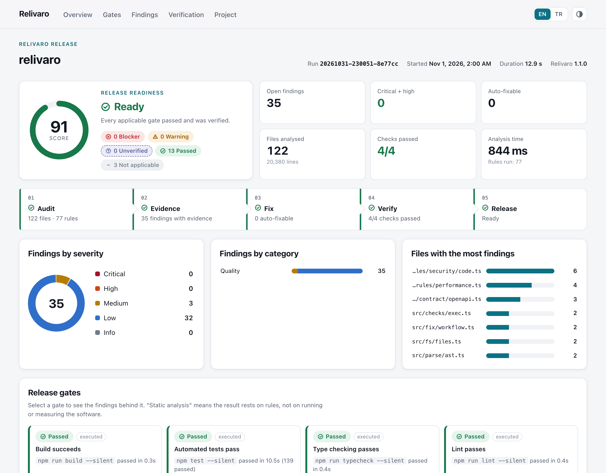
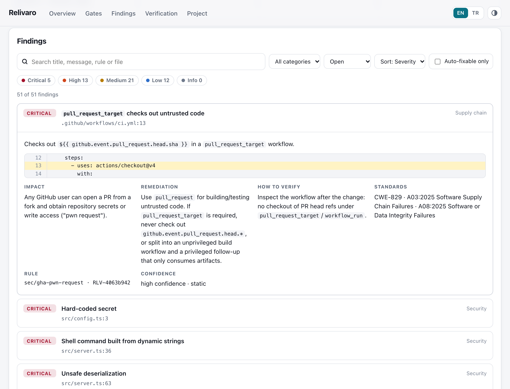
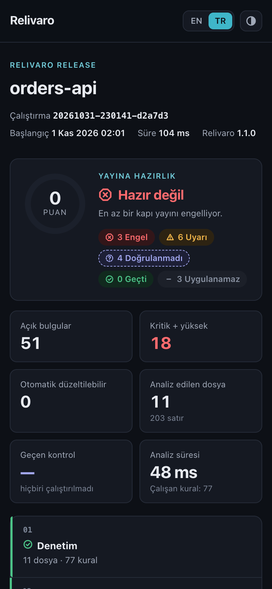
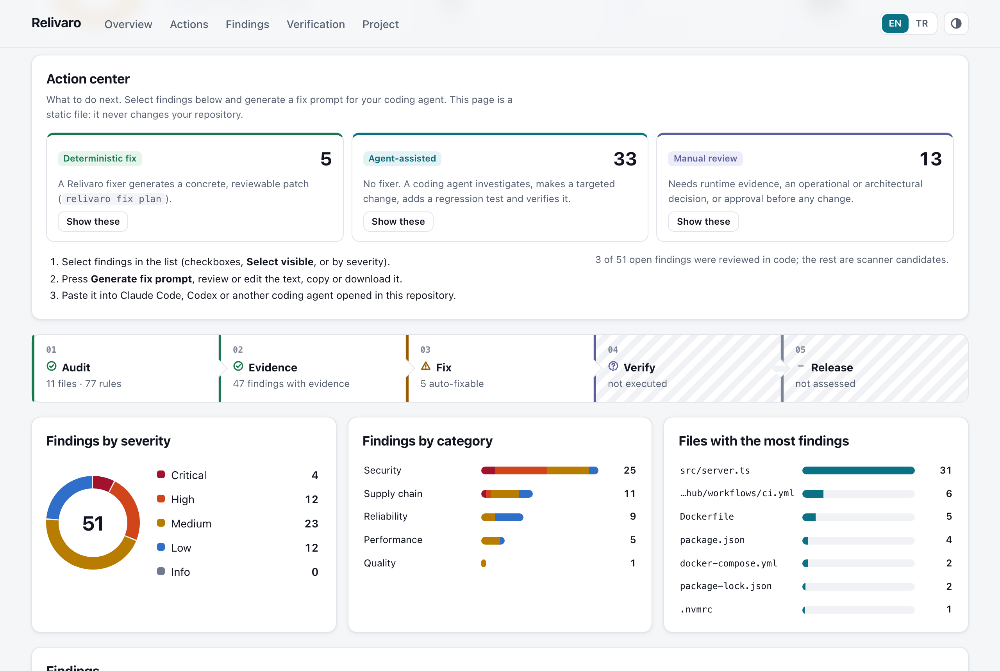
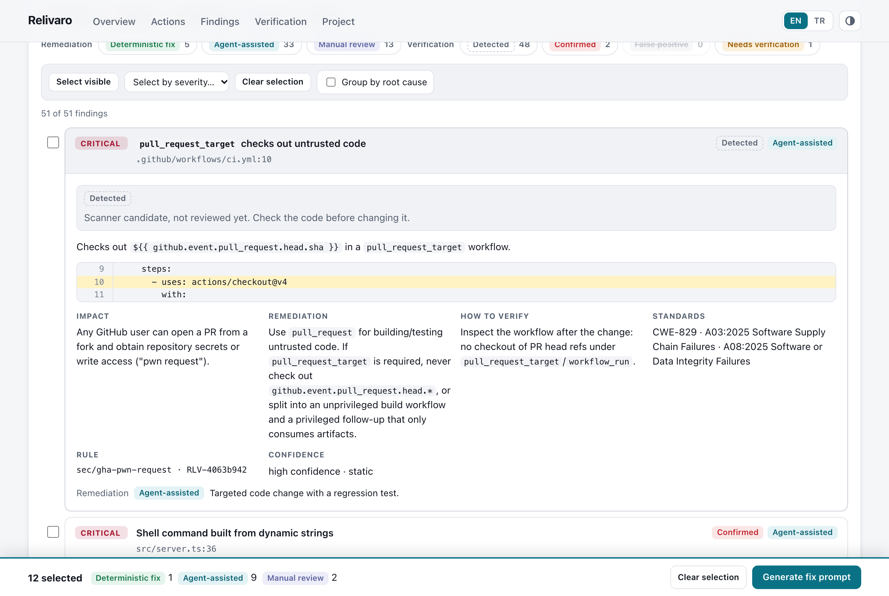

<h1 align="center">
  <picture>
    <source media="(prefers-color-scheme: dark)" srcset="assets/brand/primary-reversed.svg">
    
  </picture>
</h1>

<h3 align="center">Verify the code. Prove the quality. Ship with confidence.</h3>

<p align="center">
  Open-source release engineering for real codebases: an offline audit engine that shows its evidence,<br>
  fixes that are verified before they touch your tree, and release gates that never hide what they did not check.
</p>

<p align="center">
  <a href="https://www.npmjs.com/package/relivaro"></a>
  <a href="https://github.com/cihantopac/relivaro/actions/workflows/ci.yml"></a>
  <a href="LICENSE"></a>
  
  
</p>

<p align="center">
  <a href="#quick-start">Quick start</a> ·
  <a href="#in-claude-code">Claude Code</a> ·
  <a href="#the-report">The report</a> ·
  <a href="#evidence">Evidence</a> ·
  <a href="#limitations">Limitations</a> ·
  <a href="docs/">Docs</a>
</p>

<p align="center">
  <picture>
    <source media="(prefers-color-scheme: dark)" srcset="assets/screenshots/report-hero-dark.png">
    
  </picture>
</p>

## Why Relivaro

Most scanners give you a list. Relivaro gives you a decision you can defend.

- **Evidence, not opinions.** Every finding carries the file and line, a redacted snippet, structured facts,
  confidence, impact, remediation, how to verify it, and CWE/OWASP mapping.
- **Fixes you can trust.** Deterministic, syntax-tree fixers. A fix is re-analysed and, if you want, tested in an
  isolated copy *before* your working tree changes — with backups and hash-guarded rollback.
- **Honest release gates.** Build, tests, secrets, security, dependencies, CI, migrations and more, each marked as
  executed, measured, static analysis or **not run**. Unverified is a state, never a silent pass.
- **Safe by default.** Offline and read-only. Project code runs only with `--allow-exec`, the network is used only
  with `--online`, and files change only through `fix apply --yes`.

## How it works

<p align="center">
  <picture>
    <source media="(prefers-color-scheme: dark)" srcset="assets/diagrams/workflow-dark.svg">
    
  </picture>
</p>

| | What happens | You get |
| --- | --- | --- |
| **Audit** | Project intelligence (stacks, monorepo units, data stores, CI/CD, routes, env vars) and 83 rules over tree-sitter syntax trees with intra-procedural taint | Findings with confidence, not keyword hits |
| **Evidence** | Each finding is tied to code, facts and standards; secrets are always redacted | A reason to act — or to suppress with a reason |
| **Fix** | 15 deterministic fixers produce a reviewable diff plan; everything else gets a fix prompt for your coding agent | Nothing changes until you approve |
| **Verify** | Targeted findings must disappear, nothing new may appear, your test command must still pass | `verified`, `static-only` or a refused change |
| **Release** | Gates combine executed checks, measurements and static analysis | ready · ready with warnings · needs verification · not ready |

## Quick start

Use Relivaro inside Claude Code, from the terminal, or both — the plugin bundles the same engine.

### In Claude Code

```text
/plugin marketplace add cihantopac/relivaro
/plugin install relivaro@relivaro
```

Then run `/relivaro` in your project (restart Claude Code if the command does not show up yet). From a terminal:

```bash
claude plugin marketplace add cihantopac/relivaro
claude plugin install relivaro@relivaro
```

### As a CLI

```bash
npm install -g relivaro
```

```bash
# Everything, offline and read-only
relivaro audit .

# Run build and tests, check OSV.dev, assess release readiness
relivaro release . --allow-exec --online
```

The summary ends with the path of the HTML report and the command that opens it (or add `--open`). In the report,
select findings and press **Generate fix prompt** to hand them to Claude Code, Codex or another coding agent.
`report.md`, `report.json` and `report.sarif` sit next to it. No install? Use `npx relivaro audit .`. Requires
Node.js 22+; no native builds, no install scripts, no runtime dependencies.

### Fix, verify, roll back

```bash
# Diffs only, nothing changes
relivaro fix plan .

# Verified in an isolated copy before your tree changes
relivaro fix apply latest --yes --verify "npm test" --allow-exec

# Refuses to overwrite edits made after the fix
relivaro fix rollback latest
```

A multi-file apply is transactional: if any write fails, the files already written are restored. An interrupted
apply can be rolled back, and a forced rollback saves your later edits before restoring.

### Review and hand off

```bash
# Record what you verified in code; the report shows it next to the raw detection
relivaro review add --finding RLV-3f9a1c2b --verdict false-positive --reason "escaped by the template engine"

# Before repairing findings from an earlier run: still there, moved, or gone?
relivaro recheck . --finding RLV-3f9a1c2b,RLV-7fb00c34 --run latest

# Pin GitHub Actions to the commit their tag points to (resolved from the action's repository)
relivaro fix plan . --rule sec/gha-unpinned-action --online
```

### More

```bash
# Code, supply chain and known vulnerabilities
relivaro security . --online

# Measured benchmarks with baselines
relivaro bench . --cmd "npm run build" --runs 10 --allow-exec

# Load test (local and private targets only)
relivaro load http://localhost:3000/health --duration 15

# Breaking API changes against a git ref
relivaro contract diff openapi.yaml --base main

# CI workflow with SARIF upload to GitHub code scanning
relivaro init --github-action
```

## The report

One self-contained HTML file per run: no CDN, no fonts, no network — open it from disk or attach it to a ticket.

<table>
  <tr>
    <td width="66%"></td>
    <td width="34%"></td>
  </tr>
  <tr>
    <td><sub>Findings explorer: search, filter by severity, category, gate or fixability; evidence with the reported line highlighted.</sub></td>
    <td><sub>Responsive, light and dark, <b>English | Türkçe</b>.</sub></td>
  </tr>
</table>

<table>
  <tr>
    <td width="50%"></td>
    <td width="50%"></td>
  </tr>
  <tr>
    <td><sub>Action center: what a fixer can patch, what a coding agent can fix, what needs a decision first.</sub></td>
    <td><sub>Select findings, then <b>Generate fix prompt</b> for Claude Code, Codex or any coding agent. Detected, confirmed and false-positive findings are labelled.</sub></td>
  </tr>
</table>

Gate tiles show what each result rests on; charts are drawn only from what the run measured; a "what this run did
not verify" panel lists every limitation. Details: [docs/REPORT.md](docs/REPORT.md).

## Coverage

| Area | Highlights |
| --- | --- |
| Security · 37 rules | Injection (SQL/NoSQL/command/code/template), XSS, SSRF, path traversal, open redirects, unsafe deserialization, weak crypto, TLS, JWT, CORS, CSRF, cookies, mass assignment, XXE, ReDoS, secrets, CI/CD script injection, container hardening |
| Supply chain · 14 rules | Lockfiles, non-registry sources, install scripts, unpinned dependencies and GitHub Actions, end-of-life runtimes, known vulnerabilities via [OSV.dev](https://osv.dev) |
| Reliability · 16 rules | Timeouts, swallowed exceptions, payment idempotency, races, queue retries, destructive migrations, graceful shutdown, health checks, monitoring |
| Performance · 6 rules | N+1 queries, counting by loading rows, unbounded queries, blocking I/O, catastrophic backtracking, missing indexes — plus measured benchmarks and load tests |
| Quality & testing · 9 rules | Debug leftovers, complexity, disabled type checks, focused/skipped tests; executes build, tests, type checker and linter; reads coverage; ranks untested risk |
| API contracts | OpenAPI 3.x / Swagger 2.0 validation and breaking-change detection |

Source-level rules cover **JavaScript, TypeScript (JSX/TSX), PHP and Python**. Go, Ruby, Java/Kotlin, Swift,
Dart/Flutter and Rust projects get project intelligence, dependency, configuration, CI/CD and secret analysis.
Rule reference: [docs/RULES.md](docs/RULES.md).

## Claude Code plugin

Installed as shown in [Quick start](#in-claude-code). `/relivaro` runs the whole flow, or use `/relivaro:audit`, `:security`, `:performance`, `:reliability`, `:test`,
`:optimize` and `:release`. Claude runs the bundled engine, checks significant findings in your code, asks before
executing project commands, going online or editing anything, and reports in your language.
[docs/PLUGIN.md](docs/PLUGIN.md)

## Evidence

Numbers from the 1.1.0 release build (Apple M4, Node 22). They describe the test corpus and these machines, not
real-world accuracy in general.

| Claim | Measurement |
| --- | --- |
| Tests | **139 tests** (unit, integration, security, end-to-end) on Linux, macOS and Windows × Node 22 and 24 in CI |
| Detection corpus | 7 fixture projects, **155 expected findings: precision 100%, recall 100%**, 77 rules exercised — enforced in CI. A controlled corpus: real code will produce false positives and misses |
| Real repositories | Validated read-only on 5 production codebases (Laravel + Flutter + Python monorepo, a Next.js site, three TypeScript CLIs); every significant finding checked by hand, false-positive patterns fixed and kept as regression fixtures — [docs/VALIDATION.md](docs/VALIDATION.md) |
| Speed | 3,060-file synthetic repository in **1.39 s** (2,207 files/s, peak RSS 129 MB); a 241k-line monorepo in about 3 s — [docs/BENCHMARKS.md](docs/BENCHMARKS.md) |
| Fix safety | Regression tests for interrupted and failed multi-file applies, corrupt backups, forced rollbacks and symlinks in the verification copy |
| Report safety | Tests inject `</script>` payloads through analysed source; the report stays inert and makes no network requests |

## Limitations

- Taint tracking is intra-procedural; flows across functions or files are not followed. Low-confidence findings never
  block a release.
- No syntax-tree rules for Go, Ruby, Java/Kotlin, Swift, Dart, Rust or C#.
- Static performance findings are suspicions until measured with `bench` or `load`.
- Not a DAST tool or fuzzer; authorization logic and business rules still need human review.
- `--allow-exec` runs project code with process controls, not a sandbox: use a container or VM for untrusted code.
- Passing Relivaro does not mean software is secure or bug-free. Details:
  [docs/SECURITY_MODEL.md](docs/SECURITY_MODEL.md).

## Documentation

[CLI](docs/CLI.md) · [Configuration](docs/CONFIG.md) · [Rules](docs/RULES.md) · [HTML report](docs/REPORT.md) ·
[Plugin](docs/PLUGIN.md) · [Security model](docs/SECURITY_MODEL.md) · [Architecture](docs/ARCHITECTURE.md) ·
[Validation](docs/VALIDATION.md) · [Benchmarks](docs/BENCHMARKS.md) · [Release readiness](docs/RELEASE_READINESS.md) ·
[Changelog](CHANGELOG.md)

## Product family

Independent tools by the same author. Each works on its own; none requires another.

| | |
| --- | --- |
| [**Markilo**](https://github.com/cihantopac/markilo) | Brand identity and vector design — researched, verified, exported |
| [**Searvex**](https://github.com/cihantopac/searvex) | SEO, GEO and search intelligence with sourced audits |
| [**Jourilo**](https://github.com/cihantopac/jourilo) | UX, user journeys and conversion engineering in a real browser |
| **Relivaro** | Software quality, security and release readiness |

## Brand

The Relivaro logo, symbol and icons (the SVG files in [`assets/brand/`](assets/brand/)) were designed with
[Markilo](https://github.com/cihantopac/markilo), the open-source brand identity studio for Claude Code.

## License

[Apache-2.0](LICENSE). Bundled tree-sitter runtime and grammars are MIT-licensed; see
[THIRD_PARTY_NOTICES.md](THIRD_PARTY_NOTICES.md).
