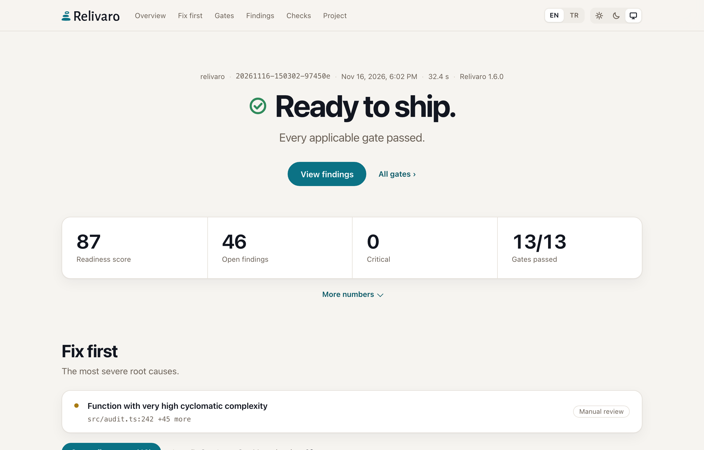
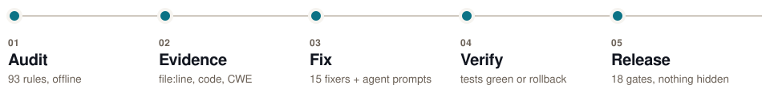
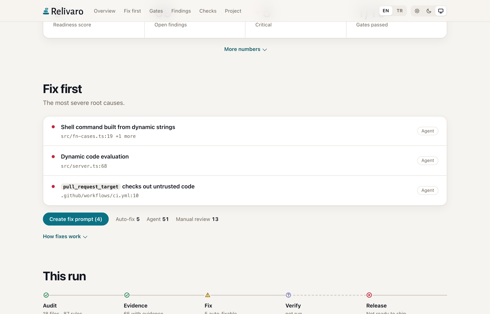
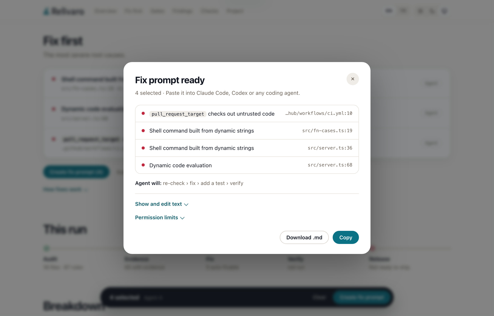
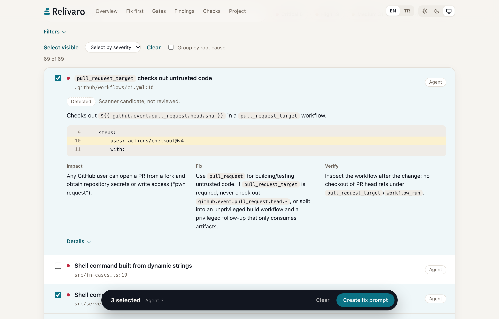
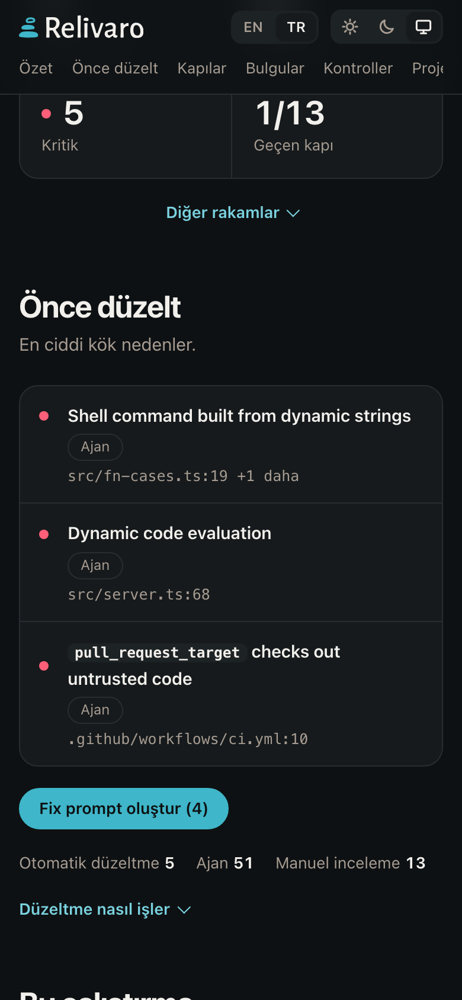

<h1 align="center">
  <picture>
    <source media="(prefers-color-scheme: dark)" srcset="https://raw.githubusercontent.com/cihantopac/relivaro/main/assets/brand/primary-reversed.svg">
    
  </picture>
</h1>

<p align="center"><strong>Verify the code. Ship with confidence.</strong></p>

<p align="center">
  Open-source code auditor for security, reliability and release readiness.<br>
  Every finding comes with evidence. Fixes go to verified fixers or your coding agent.
</p>

<p align="center">
  <a href="https://www.npmjs.com/package/relivaro"></a>
  <a href="https://github.com/cihantopac/relivaro/actions/workflows/ci.yml"></a>
  <a href="LICENSE"></a>
  
</p>

<p align="center">
  <picture>
    <source media="(prefers-color-scheme: dark)" srcset="https://raw.githubusercontent.com/cihantopac/relivaro/main/assets/screenshots/report-overview-dark.png">
    
  </picture>
  <br><sub>A real report, captured unedited: Relivaro on its own repository, with build, tests, type check and lint executed. One offline HTML file.</sub>
</p>

## Quick start

**Claude Code plugin**, no npm install needed:

```text
/plugin marketplace add cihantopac/relivaro
/plugin install relivaro@relivaro
```

Then run `/relivaro` in your project. Claude checks significant findings in the code and asks before running project
commands, going online or editing anything. [Plugin guide](docs/PLUGIN.md)

**CLI**, Node.js 22+, no runtime dependencies:

```bash
npm install -g relivaro
```

```bash
relivaro audit . --open
```

```bash
relivaro release . --allow-exec --online
```

Reports land in `.relivaro/runs/<run-id>/` as HTML, Markdown, JSON and optional SARIF. All commands:
[docs/CLI.md](docs/CLI.md).

## How it works

<picture>
  <source media="(prefers-color-scheme: dark)" srcset="https://raw.githubusercontent.com/cihantopac/relivaro/main/assets/diagrams/workflow-dark.svg">
  
</picture>

| | |
| --- | --- |
| **Audit** | 93 rules on syntax trees with taint tracking, plus project intelligence: stacks, units, data stores, CI/CD, routes. |
| **Evidence** | `file:line`, the code, impact and CWE/OWASP mapping for every finding. Secrets redacted. |
| **Fix** | 15 deterministic fixers write a reviewable diff. Everything else becomes a prompt for your coding agent. |
| **Verify** | A fix must remove its findings, add none and keep your tests green, or it is rolled back. |
| **Release** | Up to 18 gates, each marked *executed*, *measured*, *static analysis* or *not run*. Unverified is never a pass. |

## From findings to fixes

<table>
<tr>
<td width="50%" valign="top">
<picture>
  <source media="(prefers-color-scheme: dark)" srcset="https://raw.githubusercontent.com/cihantopac/relivaro/main/assets/screenshots/report-actions-dark.png">
  
</picture>
<p><b>Start with what matters.</b> The most severe root causes come first, each with its location and how it gets fixed.</p>
</td>
<td width="50%" valign="top">
<picture>
  <source media="(prefers-color-scheme: dark)" srcset="https://raw.githubusercontent.com/cihantopac/relivaro/main/assets/screenshots/report-prompt-dark.png">
  
</picture>
<p><b>Hand it to your agent.</b> One click builds a prompt for Claude Code, Codex or any agent. The agent re-checks each finding, rejects false positives and asks before changing code.</p>
</td>
</tr>
<tr>
<td width="50%" valign="top">
<picture>
  <source media="(prefers-color-scheme: dark)" srcset="https://raw.githubusercontent.com/cihantopac/relivaro/main/assets/screenshots/report-findings-dark.png">
  
</picture>
<p><b>Every claim is checkable.</b> The code behind each finding, its impact, the fix and how to verify it. Review verdicts show who checked it.</p>
</td>
<td width="50%" valign="top" align="center">

<p><b>English and Türkçe, light and dark, on any screen.</b></p>
</td>
</tr>
</table>

## Safe by default

- **Read-only and offline.** Project code runs only with `--allow-exec`; the network is used only with `--online`.
- **Changes are reversible.** Files change only through `fix apply --yes`, with backups and hash-guarded rollback.
- **The report is inert.** One self-contained file: no network, no CDN, a strict CSP, secrets redacted.

<details>
<summary><b>Scanning untrusted code</b></summary>

`--lockdown` (or `RELIVARO_LOCKDOWN=1`) turns every opt-in into a usage error (exit 2): `--allow-exec`, `--online`,
`--open`, `fix apply`/`rollback`, `baseline`, `init`, `load`, `bench`, `review add`, and writing reports into the
audited directory (use `--workspace <dir>` or `--no-write`). It also ignores the repository's `relivaro.config.json`
and inline `relivaro-ignore`/`relivaro-accept` comments, applies `.gitignore` to nothing and never starts git: no child
process, no socket. `--ignore-repo-config` alone uses only defaults or an explicit `--config`.

</details>

<details>
<summary><b>Programmatic use</b></summary>

`npm install relivaro`, then `import { runAudit, toSarif, compareRuns, assessRelease } from 'relivaro'` (ESM, typed).
The run record follows [schemas/run.schema.json](schemas/run.schema.json), and `--json --compact` is pinned by
[tests/fixtures/contract/compact.json](tests/fixtures/contract/compact.json). Everything else is internal.

</details>

## Evidence, not claims

- **Detection corpus:** 11 fixture projects, 185 expected findings, precision and recall 100%, enforced in CI. A
  controlled corpus: real code will produce false positives and misses.
- **Real repositories:** validated read-only on 5 production codebases, every significant finding checked by hand
  ([validation](docs/VALIDATION.md)).
- **Tested** with unit, integration, security and end-to-end suites on Linux, macOS and Windows, Node 22 and 24.
- **Fast:** a 3,060-file repository in about 1.5 s, a 241k-line monorepo in about 3 s ([benchmarks](docs/BENCHMARKS.md)).

Source rules cover **JavaScript, TypeScript, PHP and Python**. Go, Ruby, Java/Kotlin, Swift, Dart and Rust projects
get project intelligence, dependency, configuration, CI/CD and secret analysis. [Rule reference](docs/RULES.md)

**Limits.** Taint tracking is intra-procedural, static performance findings are suspicions until measured, and
Relivaro is not a DAST tool or fuzzer. `--allow-exec` uses process controls, not a sandbox. Passing Relivaro does not
mean software is secure or bug-free. [Security model](docs/SECURITY_MODEL.md)

## Documentation

[CLI](docs/CLI.md) · [Configuration](docs/CONFIG.md) · [Rules](docs/RULES.md) · [HTML report](docs/REPORT.md) ·
[Plugin](docs/PLUGIN.md) · [Security model](docs/SECURITY_MODEL.md) · [Architecture](docs/ARCHITECTURE.md) ·
[Release readiness](docs/RELEASE_READINESS.md) · [Changelog](CHANGELOG.md)

## Related tools

Independent open-source tools by the same author:

- [**Searvex**](https://github.com/cihantopac/searvex): SEO and AI-search auditing with sourced findings.
- [**Jourilo**](https://github.com/cihantopac/jourilo): UX and conversion engineering in real browser journeys.
- [**Markilo**](https://github.com/cihantopac/markilo): brand identity and vector design for Claude Code. It made the
  Relivaro identity.

## License

[Apache-2.0](LICENSE). The bundled tree-sitter runtime and grammars are MIT-licensed; see
[THIRD_PARTY_NOTICES.md](THIRD_PARTY_NOTICES.md).
